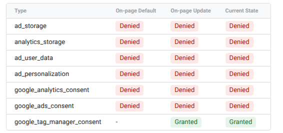

# Klaro Geo

This plugin integrates the [Klaro](https://github.com/KIProtect/klaro) consent management tool with the [Geolocation IP Detection](https://en-ca.wordpress.org/plugins/geoip-detect/) Wordpress plugin to allow you to target different consent banners using Klaro.

It is designed to work with Google Tag Manager where Klaro controls the loading of Google Tag Manager. For optimal reliability, we recommend loading Google Tag Manager via the plugin settings page rather than manually adding it to your site. This ensures the GTM snippet is properly customized to integrate with Klaro.

It allows you to create and manage multiple consent banner templates, assign each template to users by location, and track consent decisions for compliance purposes.

This plugin gives you a lot of control over how consent is managed and tracked across your website. Using this plugin does not guarantee that you will be compliant with applicable laws and regulations. 

**You are responsible for ensuring compliance with all applicable laws and regulations.**

## Features

- **Geolocation-Based Consent Management**: Display different consent banners based on user location (country and region).
- **Template System**: Create and manage multiple consent banner templates.
- **Google Tag Manager Integration**: Built-in support for Google Tag Manager with zero-config consent mode.
- **Google Consent Mode v2**: Support for Google's basic and advanced consent mode.
- **Simplified GTM Consent Triggers**: Custom Consent Mode consent keys allow for a cleaner triggering of consented services in Google Tag Manager.
- **Fallback Templates**: Use strict fallback templates to prevent accidental violations of local law.
- **Granular Consent Receipts**: When enabled, each consent choice is recorded as a receipt in your WordPress database, with a copy kept in the visitor's browser. Consent logging can be switched off per template, so you keep records only for the jurisdictions that require them; a template with logging off produces no receipts at all.
- **Consent Buttons**: Add a floating button or integrate with WordPress menus to allow users to easily access consent settings.
- **Global Privacy Control (GPC)**: Detects the `navigator.globalPrivacyControl` browser signal and automatically adjusts consent defaults for affected services. Configurable per-template and per-service.
- **Data Layer Integration**: Forwards Klaro's own events to the dataLayer and pushes its own consent status events, so tag managers and analytics can react. A consent-aware queue (`klaroGeo.push`) holds your events until consent state is set.
- **Cache-Safe Geo Resolution**: On hosts with full-page caching, the visitor's browser can resolve the location and pick the template, so a cached page never serves one visitor's banner to another. See [Client-Side Geo Resolution](#client-side-geo-resolution).
- **Admin Debug Tools**: Test different geolocation scenarios directly from the admin bar.

## Requirements

- WordPress 5.7 or later and PHP 7.2 or later. The test suites run on both the oldest supported versions and the current ones.
- [GeoIP Detection](https://wordpress.org/plugins/geoip-detect/) plugin (for geolocation features to work)

## Installation

1. Install the GeoIP Detection plugin from the WordPress plugins directory
2. Upload the `klaro-geo` folder to the `/wp-content/plugins/` directory
3. Activate the plugin through the 'Plugins' menu in WordPress admin
4. Configure Klaro Geo settings under the 'Klaro Geo' menu in the WordPress admin

## Configuration

### Quick Start Guide

**Important**: Configuration order matters. You must define foundational settings (like Purposes) before you can assign them to Services or configure Translations.

Please follow the steps below in order to ensure a smooth setup and avoid having to backtrack.

1. Go to the main settings page **Klaro Geo > Klaro Geo** and ensure the following settings are configured correctly:
  - Google Tag Manager ID is set.
  - Purposes are configured as desired.
2. Go to the services page **Klaro Geo > Services** and configure your services
  - If you plan on using consent mode, be sure that your consent mode services are configured before proceeding to the next step.
  - The service-level **Required** and **Default** fields override the template-level fields of the same name. Any services that should behave differently from the templates need to be configured here. This includes services assigned to required or security purposes.
  - Assign each service to one or more purposes
3. Go to the templates page **Klaro Geo > Templates** and customize the default template and create any other desired templates
  - Ensure that your templates have the **Default State** setting set the desired opt-in or opt-out behavior.
4. Go to the countries page **Klaro Geo > Country Settings** and map a template to the Fallback Template and to your desired countries or regions.
5. Go to Google Tag Manager and configure your tags to use consent-based firing:
  - For Google tags (GA4, Google Ads): fire on normal triggers (e.g., `All Pages`). Consent mode is handled automatically via `gtag()`.
  - For non-Google tags: use GTM's **"Require additional consent for tag to fire"** with custom consent keys (e.g., `facebook_consent`). Fire on `Klaro Consent Update` event.
  - Alternative: Create a Data Layer Variable for `acceptedServices` and use Trigger Groups for more control (see [Tag Trigger Setup](#configuring-tag-triggers-in-gtm)).

### General Settings

Navigate to **Klaro Geo > Klaro Geo** to configure the general plugin settings:
- **Klaro Geo Settings**: 
  - Enable Consent Receipts: Record consent choices as receipts in the WordPress database, with a copy in the visitor's browser (see [Consent Receipts](#consent-receipts))
- **Geo Resolution**:
  - Geo Resolution Mode: Server-side (default) or Client-side (cache-safe). Use Client-side on any host with full-page caching; see [Client-Side Geo Resolution](#client-side-geo-resolution)
  - Client Geo Lookup Timeout (ms): How long the browser waits for the location lookup before falling back. Client-side mode only
  - Timezone Fallback: When the lookup fails, infer the country from the browser's timezone. Client-side mode only
- **Google Tag Manager**:
  - Google Tag Manager ID: Enter your Google Tag Manager container ID (e.g., GTM-XXXXXX)
  - Consent Mode Type: Choose between Basic and Advanced consent mode (see [Basic vs Advanced Consent Mode](#basic-vs-advanced-consent-mode) below)
- **Consent Management Buttons**:
  - Enable Floating Consent Button: Create a persistent floating button that opens the Klaro service management modal. Off by default; see [Floating Button](#floating-button)
  - Button Text: Enter the text for the floating consent button
  - Button Theme: Select a style for the button
  - Button Position: Select where the button should appear on the screen
  - WordPress Menu Integration: Instructions on how to add a link that opens the Klaro service management modal into your WordPress menus
  - Shortcode: Instructions on how to use a shortcode to add a link that opens the Klaro service management modal into your WordPress pages
- **Purposes**:
  - Purposes (comma-separated): List of purposes by which you want to group your tags
- **Global Privacy Control (GPC)**: see [Global Privacy Control](#global-privacy-control-gpc)
- **Data Layer Settings**:
  - Suppress Individual Klaro Consent Event dataLayer Pushes: Klaro sends a "consents" event every time an individual consent toggle is changed in the consent banner. These don't take effect until the user saves their choices, at which point the plugin sends a consolidated event. Klaro Geo is configured to forward Klaro events to the dataLayer. Enabling this setting (recommended) suppresses the individual toggle events, which can pollute the dataLayer when users toggle multiple settings. Disable this only if you need to track individual consent toggle interactions within the banner.

- **Debug Settings**:
  - Enable Plugin Debug Logging: When enabled, the plugin will output debug messages to WordPress logs (PHP) and browser console (JavaScript). Useful for troubleshooting but should be disabled in production to reduce log noise. Note: WP_DEBUG must also be enabled for PHP logging to work.
  - Debug Countries/Regions (comma-separated): Enter a list of two-digit country codes or ISO 3166-2 region codes (e.g., US, UK, US-CA, CA-QC). These codes will populate a dropdown in the WordPress Admin Bar, allowing you to simulate browsing from those locations to test your Klaro configuration.
  - Plugin Cleanup: Remove all settings when deactivating the plugin. You will need to reconfigure everything if you reactivate the plugin.
  - Consent Receipts on Delete: Deleting the plugin from the Plugins screen always removes its settings. Stored consent receipts are kept unless this is checked.

### Templates

Templates define the language, layout, and behavior of the consent banner displayed to users. Templates get assigned to countries and regions so that you can change consent features and language by jurisdiction. 

Most of the template settings are derived directly from Klaro settings. Template-specific Klaro Geo settings include additional Google settings (ads_data_redaction, url_passthrough) and Consent Logging.

You can not delete templates that are currently assigned to countries or regions. To remove a template, you must first unassign it on the Country Settings page.

Navigate to **Klaro Geo > Templates** to manage consent banner templates.

- **Basic Settings**: 
  - Version: Klaro configuration version.
  - Element ID: Klaro HTML element ID for the Klaro container.
- **Styling**:
  - Theme Color: Choose between Klaro's default light and dark themes.
  - Position: Position of the consent notice.
  - Width: Width of the consent notice.
- **Behavior Settings**:
  - Default State: Default state for services if the user doesn't make a choice
  - Required: When enabled, every service whose Required field is "Use Global Setting" is required in this template: visitors cannot decline it and it loads on every page. Services set to Yes or No on the Services page ignore this. This is how one service, typically Google Tag Manager, can be required in some templates and consent-gated in others.
  - HTML Texts: Allow HTML in text fields.
  - Embedded Mode: If enabled, Klaro will render without the modal background, allowing you to embed it into a specific element of your website, such as your privacy notice. 
  - No Auto Load: If enabled, Klaro will not automatically load itself when the page is being loaded. You'll need to manually trigger it.
  - Auto Focus: Automatically focus the consent modal when it appears.
  - Group by Purpose: Group services by their purpose in the consent modal.
- **Cookie Settings**:
  - Storage Method: Save consent choices in a cookie or local storage.
  - Cookie Name: Name of the cookie.
  - Cookie Expires (days): Set the cookie expiry duration in days.
  - Cookie Domain: Domain for the cookie.
  - Cookie Path: Path for the cookie.
- **Consent Modal Settings**:
  - Must Consent: If enabled, users must make a choice before using the site.
  - Accept All: Show an "Accept All" button.
  - Hide Declining All: Hide the "Decline All" button.
  - Hide Learn More: Hide the "Learn More" link.
  - Show Notice Title: Show the title in the consent notice.
  - Show Description for Empty Store: Show description text even when no services are defined.
  - Disable Powered By: Hide the "Powered by Klaro" text.
  - Additional CSS Class: Additional CSS class to add to the consent modal.
  - Default Language: Default language code (e.g., 'en', 'de'). Leave empty to use the fallback language and translation settings ('zz').
#### Consent Mode Settings:
  Consent mode is always enabled. The standard Google Consent Mode signals (`ad_storage`, `analytics_storage`, `ad_user_data`, `ad_personalization`) are controlled by dedicated [consent mode services](#consent-mode-services) configured in the Services section. Consent defaults for each service are determined by the service's required/default state and this template's Default State setting.
  - ##### Additional Google Settings
    - ads_data_redaction: Manage the redaction of ad click identifiers when `ad_storage` is denied
    - url_passthrough: Manage the appending of ad click identifiers as URL parameters when `ad_storage` or `analytics_storage` is denied
  - ##### Service Consent Defaults
    - Read-only view of the custom consent key and default state for each service
- **Plugin Settings**:
  - Enable Consent Logging: Log consent choices for this template in the WordPress database.

#### Translations:
Klaro consent translation settings. All translation settings except for service names and descriptions are managed here in the template settings.

This allows you to create language specific to a legal jurisdiction, for example "do not sell my data" notices in California, and assign the template to that location.

  - Translation Settings: Configure translations for various text elements in the consent notice.
  - Advanced Translations (JSON): Edit translations JSON directly. This is useful for copying and pasting translations between templates.


### Country Settings

Set your fallback template, assign templates to countries and override country templates with region templates.

Navigate to **Klaro Geo > Country Settings** to assign templates to specific locations:

1. Assign a template to the Fallback Template row.
2. From the dropdown menu in the template column of your chosen country's row, select a template.
3. Select `Manage Regions` to override country settings in specified regions as desired.
4. Select `Hide` to remove a country from the Klaro Geo Country Settings table as desired.
5. Select `Show/Hide Countries` to add and remove countries from the Klaro Geo Country Settings table as desired.
6. Changes to a template dropdown are saved as you make them; `Save` stores the whole form.

### Services
Manage services that should show in the consent modal.

Klaro automatically manages [third-party inline scripts](https://klaro.org/docs/getting-started) when the following conditions are met:
- The script has a `type` attribute set to `text/plain`
- The script has a `data-type` attribute set to `application/javascript`.
- The script has a `data-name` attribute matching the service name as defined on this page.

Klaro Geo automatically embeds Google Tag Manager this way.

It should be possible to use this plugin to manage other inline scripts without using Google Tag Manager or to implement other tag managers. However, it will require advanced knowledge of Klaro, Google Tag Manager, and Klaro Geo to get it to work correctly.

Klaro Geo adds a `Klaro Consent Update` dataLayer push whenever consent is updated with custom consent keys as well as an `acceptedServices` array containing the names of services that are currently accepted.



Use custom consent keys with GTM's **"Require additional consent for tag to fire"** to gate any tag on a specific service's consent (e.g., add `facebook_consent` to a Facebook Pixel tag). Alternatively, use the `Klaro Consent Update` event with a Data Layer Variable trigger condition (e.g., `consentMode.facebook_consent` equals `granted`). The `acceptedServices` array is for use in situations where Google Consent Mode is not applicable (like when using a tag manager other than Google Tag Manager).

Navigate to **Klaro Geo > Services** to manage services:

Use the `Add New Service`, `Edit`, and `Delete` buttons to manage services.

Each service gets the following settings that Klaro consumes and uses:

- Name: The name of the service as it will appear in the acceptedServices array in lowercase with spaces replaced with hyphens.
- Required: Display the service but do not allow visitors to turn off the service. Overrides the template-level setting of the same name. 

**Functional service warning**: Setting a purpose to 'functional' or 'security' or some other purpose that does not require consent does not mean the service is automatically loaded. A service loads without consent only when it is required: set its `Required` field here to "Yes", or leave it on "Use Global Setting" and enable **Required** on the templates where it should be required.
- Default: Load this service by default before the consent banner is interacted with. Overrides the template-level setting of the same name.
- Purpose: Select the purpose(s) associated with this service. The list of purposes is managed on the main settings page at **Klaro Geo > Klaro Geo > Purposes (comma-separated)**. It is best to decide on your list of purposes before you start assigning them here.
- Advanced Settings: Manage additional Klaro settings for the service (these have not been tested with the plugin).

#### Running your own code when consent changes

Services do not have callback script fields. To react to a visitor's choice:

- **Load a script only with consent:** mark it up as an inline script Klaro manages (see the top of this section).
- **With Google Tag Manager:** fire a tag on the `Klaro Consent Update` event and gate it with the service's custom consent key.
- **Without a tag manager:** watch Klaro's consent manager from your theme. This runs once on page load and again each time the visitor saves a choice:

```javascript
(function start() {
  // Wait until Klaro and its config are on the page (in client-side geo
  // mode the config arrives after the geo lookup).
  if (!window.klaro || !window.klaroConfig) {
    return setTimeout(start, 100);
  }

  var manager = window.klaro.getManager();

  function apply() {
    if (manager.consents['facebook-pixel']) {
      // The service is accepted.
    } else {
      // The service is declined, or the visitor has not chosen yet.
    }
  }

  apply();
  manager.watch({
    update: function (obj, name) {
      if (name === 'saveConsents') {
        apply();
      }
    }
  });
})();
```

#### Service Translations (only shown when editing a specific service)

The default Fallback translation tab sets the Klaro `zz` translation key for each service.

New languages need to be configured in a template on the Templates page before you can set translation settings here.

Manage the following service-specific translation fields here:

- Title: This is the human-readable name of the service. It should be populated automatically in title-case from the service name.
- Description: A brief description of what the service does.

### Consent Receipts Page

**Klaro Geo > Consent Receipts** lets you browse the consent receipts stored in WordPress. See [Consent Receipts](#consent-receipts) for what a receipt holds.

Consent receipts need to be enabled under **Klaro Geo > Klaro Geo > Enable Consent Receipts** for you to see data here.

You will only see receipts from countries and regions whose template has **Enable Consent Logging** on (**Templates > select the template > Plugin Settings**).

## Adding Consent Buttons

There are multiple ways to add consent management buttons to your site:

### WordPress Menu Integration

You can add a consent management button to any WordPress menu using a custom link:

1. Go to **Appearance > Menus** in your WordPress admin
2. Create a new menu or edit an existing one
3. In the "Custom Links" section, add a link with:
   - **URL**: # (just a hash symbol)
   - **Link Text**: "Manage Cookies" or whatever text you prefer
4. Click "Add to Menu"
5. Expand the newly added menu item
6. In the **"CSS Classes (optional)"** field, add the class `open-klaro-modal`
   - **IMPORTANT**: While the field is labeled "optional" in WordPress, the `open-klaro-modal` class is **required** for the menu item to open the Klaro modal. Without this class, the link will not function.
7. Save the menu

When clicked, this menu item will open the Klaro consent management popup, allowing users to update their consent preferences at any time.

### Shortcode

You can use the `[klaro_consent_button]` shortcode to add a consent button anywhere shortcodes are supported:

```
[klaro_consent_button text="Manage Cookie Settings" class="my-custom-class" style="button"]
```

Parameters:
- **text**: (Optional) The button text. Defaults to the text configured in settings.
- **class**: (Optional) Additional CSS classes to add to the button.
- **style**: (Optional) Set to "link" for a text link instead of a button.

Examples:
```
[klaro_consent_button]
[klaro_consent_button text="Privacy Settings" style="link"]
[klaro_consent_button class="button button-primary" text="Cookie Settings"]
```

### Embedding the Consent Manager in a Page

The `[klaro_embedded]` shortcode places the consent manager inside a page, such as your privacy notice, instead of showing it as a popup. It needs **Embedded Mode** enabled on the template the visitor gets.

```
[klaro_embedded]
[klaro_embedded id="my-consent" class="my-class" style="min-height: 400px;"]
```

### Floating Button

The plugin also provides a floating button option that can be enabled in the settings. This button can be configured to appear at the bottom or top to the left or right of the viewport and is always accessible to visitors.

The floating button is off by default. Most sites will want to style it to match their theme before showing it to visitors: override the `.klaro-floating-button` rules (and the `.klaro-theme-*` / `.klaro-position-*` variants) in your theme's CSS, then enable it under **Klaro Geo > Klaro Geo**. The menu item and shortcode work whether or not the floating button is enabled.

## Customizing Klaro Appearance

Klaro has built-in theme settings and Klaro Geo has theme settings for the floating consent button.

Klaro (version 0.7) is bundled with the plugin and served from your own site; nothing is loaded from a CDN.

The translation settings for the plugin are managed in template and service configurations.

Developers can set custom CSS classes and override Klaro's default styles. 

The GeoIP Detection plugin also includes an option to add the detected country and region as a class to the body element. This can be used to customize the appearance of the consent banner based on the visitor's location beyond the text and behavior settings provided natively by Klaro and Klaro Geo.

## Google Tag Manager Integration

The plugin directly loads Google Tag Manager in a Klaro-compatible way, ensuring proper consent management.

### Consent Mode (Zero-Config)

Klaro Geo automatically sets up Google Consent Mode v2 without any GTM template or additional configuration:

- **Consent defaults** are set via `gtag('consent', 'default', ...)` in the `<head>` before any tags load
- **Consent updates** are called via `gtag('consent', 'update', ...)` directly when users interact with the consent banner
- **Custom consent types** (e.g., `facebook_consent`) work natively with GTM's "Require additional consent for tag to fire"

This means consent mode works out of the box for both Google and non-Google tags.

### GTM Consent Gate Variable (Optional)

Klaro Geo includes an optional **Consent Gate Variable** template for GTM. This variable acts as a consent-aware wrapper -- it passes through a value when consent is granted and returns a redacted value when denied. Useful for redacting user-provided data (email, phone) when `ad_user_data` is denied, or zeroing out transaction values when `ad_storage` is denied.

For setup instructions, see the [GTM Template README](gtm-template/README.md).

### How to Set Up GTM

1. Go to **Klaro Geo > Klaro Geo > Google Tag Manager**
2. Enter your Google Tag Manager ID (e.g., GTM-XXXXXX)
3. Select your **Consent Mode Type** (Basic or Advanced) - see [Basic vs Advanced Consent Mode](#basic-vs-advanced-consent-mode) below
4. Save your settings

The plugin will automatically:
- Add the GTM script to your site's header (with Klaro gating in Basic mode, or ungated in Advanced mode)
- Add the GTM noscript iframe to your site's body
- Set Google Consent Mode defaults and update them as visitors make their choices

### Basic vs Advanced Consent Mode

Klaro Geo supports two consent mode types that control how Google Tag Manager interacts with the consent banner. Both modes use Google Consent Mode v2, which the plugin sets up itself; no GTM template is needed.

#### Basic Consent Mode (Default)

In Basic mode, **GTM is completely blocked until the user consents** to the `google-tag-manager` service. No data is sent to Google before consent.

**How it works:**
1. The GTM script tag is rendered with `type="text/plain"` and `data-name="google-tag-manager"`, which prevents execution
2. When the user grants consent to the `google-tag-manager` service, Klaro changes the type to `text/javascript`, which triggers GTM to load
3. GTM picks up the consent defaults the plugin set in the `<head>` and the updates it sends as the visitor chooses
4. Tags fire according to their consent requirements

**The Site Infrastructure purpose:** the `google-tag-manager` service sits in its own **Site Infrastructure** purpose. A visitor who enables Analytics or Advertising but not Site Infrastructure has consented to those services but not to GTM, so in Basic mode none of the tags GTM would load can run. **Accept all** covers Site Infrastructure. GTM deliberately has a single purpose: Klaro shows a purpose as on whenever any of its services is on, so a service shared between two purposes makes the other purpose look enabled and a click on it turns it off instead of on. Keep each service in one purpose when Group by Purpose is enabled.

**When to use Basic mode:**
- When you want zero data collection before explicit consent
- For the strictest interpretation of GDPR and similar regulations
- When you don't need Google's behavioral modeling features

**WordPress settings:**
- Go to **Klaro Geo > Klaro Geo > Google Tag Manager**
- Set **Consent Mode Type** to **Basic**

#### Advanced Consent Mode

In Advanced mode, **GTM loads immediately** (without Klaro gating) but all consent signals default to `denied`. Google tags like GA4 can send cookieless pings before consent, enabling behavioral modeling and basic measurement without cookies.

**How it works:**
1. The GTM script tag is rendered as a normal `<script>` tag (no Klaro `type="text/plain"` gating)
2. GTM loads immediately on page load, with every consent signal set to `denied` by the plugin's defaults
3. GA4 sends cookieless pings (if configured) while consent is denied, enabling behavioral modeling
4. When the user interacts with the Klaro consent banner, consent state is updated
5. After consent is granted, full tracking begins with cookies

**When to use Advanced mode:**
- When you want to take advantage of Google's behavioral modeling (which fills in gaps in conversion data)
- When your legal interpretation allows cookieless data collection before consent
- When you want GA4 to capture anonymous page view data even without consent

**WordPress settings:**
- Go to **Klaro Geo > Klaro Geo > Google Tag Manager**
- Set **Consent Mode Type** to **Advanced**

**Important notes for Advanced mode:**
- The `google-tag-manager` service still appears in the Klaro consent dialog. Users can still toggle it off, which affects the consent state of your tags.
- `Klaro Consent Update` events are pushed on initial page load (they are not skipped like in Basic mode where GTM hasn't loaded yet).
- The optional [Consent Gate Variable](#gtm-consent-gate-variable-optional) is useful here for redacting values while consent is denied.

#### Side-by-Side Comparison

| Behavior | Basic | Advanced |
|----------|-------|----------|
| GTM loads before consent | No | Yes |
| Data sent before consent | None | Cookieless pings only (if configured in GA4) |
| Consent defaults | `denied` (set in `<head>` via `gtag`) | `denied` (set in `<head>` via `gtag`) |
| Behavioral modeling | Not available | Available |
| `Klaro Consent Update` on initial load | Skipped until the visitor consents to GTM (GTM not loaded yet) | Pushed immediately |
| GTM script tag | `type="text/plain"` with `data-name` | Normal `<script>` tag |
| User can revoke GTM consent | Yes (via consent dialog) | Yes (via consent dialog) |

#### When a Visitor Declines Google Tag Manager

In Basic mode the `google-tag-manager` service gates GTM itself. A visitor who has not consented to it (every fresh visitor until they choose, and every returning visitor who declined it) never loads GTM, so **nothing configured in GTM runs for them**: no `Klaro Consent Update` trigger, no `All Pages` trigger, no tags of any kind. This is the point of Basic mode, but it means the single-trigger setup only ever sees visitors who consented to GTM.

If you want `Klaro Consent Update` to fire on every page view, including for visitors who decline everything, choose one of:

- **Make GTM required in the templates where that fits your legal interpretation.** The `google-tag-manager` service defaults to Required = "Use Global Setting", so enabling **Required** on a template makes GTM required for visitors who get that template, while a template for, say, Germany can leave it off. Where it is required, Klaro loads GTM for every visitor and visitors cannot turn it off. (Setting the service itself to Required = Yes makes it required in every template.) Individual tags are still gated by their consent keys, so declining analytics or advertising still blocks those tags. In effect GTM behaves as in Advanced mode, so check that loading GTM before consent fits your legal interpretation.
- **Switch to Advanced mode**, which loads GTM ungated. Visitors can still toggle the `google-tag-manager` service off in the dialog, which sets `google_tag_manager_consent` to `denied` for tags that require it.

Leave GTM consent-gated (Basic mode, not required) if you need zero contact with Google before consent and accept that GTM sees nothing from visitors who decline it.

#### Configuring Tag Triggers in GTM

How you configure tag triggers differs significantly between Google tags and non-Google tags, and between Basic and Advanced consent mode. This is because Google tags have **built-in consent checks** that make them consent-aware -- they adjust their own behavior based on consent state rather than needing to be blocked or unblocked.

##### Google Tags (GA4, Google Ads) -- Advanced Mode

In Advanced mode, Google tags should fire on their **normal triggers** (e.g., `All Pages` for the Google Tag / GA4 Config, specific events for conversion tags). **Do not** add "Require additional consent for tag to fire" -- this would block the tag entirely and prevent cookieless pings.

Google tags have built-in consent checks for `analytics_storage`, `ad_storage`, `ad_user_data`, and `ad_personalization`. When these signals are `denied`, Google tags still fire but automatically send **cookieless pings** instead of full measurement data. When consent state changes (via `gtag('consent', 'update')`), Google tags automatically adjust to full tracking -- they do not need to be re-triggered.

| Phase | What happens |
|-------|-------------|
| Page load (before consent) | Google Tag fires on `All Pages`. Consent is `denied`. GA4 sends cookieless pings for [behavioral modeling](https://support.google.com/analytics/answer/11161109). No cookies are set. |
| User grants consent | Plugin calls `gtag('consent', 'update')` directly. Google tags automatically switch to full tracking with cookies. |
| Returning visitor with cookie | Plugin reads consent state on page load, calls `gtag('consent', 'update')` with `granted`. Google Tag fires on `All Pages` with full tracking from the start. |

##### Google Tags (GA4, Google Ads) -- Basic Mode

In Basic mode, GTM is completely blocked until the user consents to the `google-tag-manager` service. There are no cookieless pings and no behavioral modeling.

Google tags can fire on `All Pages` since by the time GTM loads and `All Pages` fires, consent has already been established. Alternatively, triggering on `Klaro Consent Update` also works.

| Phase | What happens |
|-------|-------------|
| Page load (before consent) | GTM is not loaded. Nothing happens. |
| User grants consent | Klaro unblocks GTM. GTM loads with the consent state the plugin has set, `All Pages` fires. Tags fire with full tracking. |
| Returning visitor with cookie | Klaro reads cookie and immediately unblocks GTM. Same as above. |

##### Non-Google Tags (Facebook Pixel, LinkedIn Insight, etc.)

Non-Google tags do not have built-in consent awareness. They cannot send cookieless pings and have no equivalent to behavioral modeling. **The configuration is the same in both Basic and Advanced mode.**

Since the plugin now calls `gtag('consent', 'update')` directly with all consent types (including custom ones like `facebook_consent`), you can use GTM's **"Require additional consent for tag to fire"** for any consent type. This is the simplest approach:

1. Open your non-Google tag (e.g., Facebook Pixel)
2. Go to **Advanced Settings** > **Consent Settings**
3. Check **Require additional consent for tag to fire**
4. Add the consent type: `facebook_consent` (use the service name with hyphens replaced by underscores, plus `_consent`)

**Alternative: DLV approach** (still works, captures more data with Trigger Groups):

1. **Create a Data Layer Variable** for the service's consent key:
   - **Data Layer Variable Name**: `consentMode.facebook_consent` (replace with your service name)
2. **Create a Custom Event trigger** for `Klaro Consent Update`:
   - Add condition: your DLV **equals** `granted`
3. **Assign the trigger** to your non-Google tag

The DLV approach works because the full `consentMode` object (including all custom consent keys) is included in the `Klaro Consent Update` dataLayer event.

| Phase | What happens (both modes) |
|-------|--------------------------|
| Page load (before consent) | Nothing. Tag is either not loaded (Basic) or blocked by trigger condition (Advanced). |
| User grants consent | `Klaro Consent Update` fires. DLV condition is met. Tag fires. |
| Returning visitor with cookie | `Klaro Consent Update` fires on page load with consent already `granted`. Tag fires immediately. |

##### Summary

- **Google tags in Advanced mode**: Fire on normal triggers (`All Pages`, etc.). Do NOT add additional consent requirements. Built-in consent checks handle cookieless pings and automatic adjustment when consent changes.
- **Google tags in Basic mode**: Fire on `All Pages` or `Klaro Consent Update`. Both work since GTM only loads after consent. No cookieless pings.
- **Non-Google tags in both modes**: Use "Require additional consent for tag to fire" with the custom consent key (e.g., `facebook_consent`). Alternatively, fire on `Klaro Consent Update` with a DLV trigger condition (e.g., `consentMode.facebook_consent` equals `granted`).

### Consent Mode Services

Klaro Geo includes four built-in **consent mode services** that map directly to Google Consent Mode v2 signals. These appear as toggleable services in the Klaro consent dialog, giving users granular control over consent signals.

| Service Name | Consent Mode Signal | Purpose | Parent |
|-------------|-------------------|---------|--------|
| `analytics-storage` | `analytics_storage` | analytics | - |
| `ad-storage` | `ad_storage` | advertising | - |
| `ad-user-data` | `ad_user_data` | advertising | `ad-storage` |
| `ad-personalization` | `ad_personalization` | advertising | `ad-storage` |

These services are automatically added to your configuration on plugin activation. They can be managed like any other service under **Klaro Geo > Services**.

**Parent-child dependencies:** `ad-user-data` and `ad-personalization` are children of `ad-storage`. If a user denies `ad-storage`, the child services are automatically denied as well, regardless of their individual toggle state.

**How these differ from regular services:** Consent mode services use their `consent_mode_key` directly (e.g., `analytics_storage`) rather than the `{service_name}_consent` format used by regular services. This means the consent signals they produce are natively recognized by Google tags without any mapping.

### Integrating Klaro Geo into Google Tag Manager

Klaro Geo adds two dataLayer pushes: 'Klaro Event' and 'Klaro Consent Update'.

#### Klaro Event

This event is fired when Klaro fires internal events as well as when Klaro Geo fires internal events. They are useful for debugging and adding consent data as Data Layer variables.

These events can include the following parameters:
- `event: "Klaro Event"`: The same for all of these events
- `eventSource: "klaro" | "klaro-geo"`: Whether the event was forwarded from Klaro or generated by Klaro Geo
- `klaroEventName`: The name of the event: `klaroConfigLoaded`, `gpcDetected`, `initialConsents`, `saveConsents`, `applyConsents`, `generateConsentReceipt`, and `consents` when individual toggle events are not suppressed
- `klaroEventData: {google-tag-manager: true, google-analytics: true}` (events forwarded from Klaro): The data Klaro passed with the event; for `initialConsents`, the consent state of every service
- `acceptedServices: ["google-tag-manager", "google-analytics"]` (events forwarded from Klaro): The names of the services currently accepted

`klaroConfigLoaded` is pushed once per page, when the template has been chosen:
- `klaroGeoConsentTemplate: "strict"`: The key of the template in use
- `klaroGeoTemplateSource: "country" | "region" | "default" | "fallback" | "hardcoded-fallback"`: The rule that chose the template
- `klaroGeoDetectedCountry: "US"`: The detected country, or null
- `klaroGeoDetectedRegion: "CA"`: The detected region, without the country, or null
- `klaroGeoAdminOverride: false`: Whether an administrator's debug location was applied
- `klaroGeoResolutionMode: "server" | "client"`: Where the location was resolved
- `klaroGeoGeoSource`: `server` or `debug` in server mode; `geoip-ajax`, `timezone` or `fallback` in client mode
- `klaroGeoGeoLatencyMs`: How long the browser's lookup took, in client mode; null in server mode
- `klaroGeoEnableConsentLogging: true | false`: Whether receipts are recorded on this page (the global setting and the template's setting)
- `klaroGeoGPCDetected`, `klaroGeoGPCEnabled`, `klaroGeoGPCAffectedServices`: see [Global Privacy Control](#datalayer-events)
- `klaroGeoConsentReceiptId: "receipt_..."`: The ID of the visitor's latest receipt, when their browser holds one and a stored consent exists

`generateConsentReceipt` is pushed when a receipt is created:
- `klaroGeoConsentReceipt: "receipt_..."`: The receipt's ID
- `klaroGeoConsentReceiptType: "choice" | "gpc"`: A choice the visitor saved, or a Global Privacy Control opt-out recorded without one
- `klaroGeoTemplateSource`, `klaroGeoAdminOverride`, `klaroGeoEnableConsentLogging`: as above

#### Klaro Consent Update

This event is pushed by the plugin after calling `gtag('consent', 'update', ...)`. This is the recommended trigger for your tags because consent is guaranteed to be set when this event fires.

Parameters:
- `event: "Klaro Consent Update"`: Hard-coded event name
- `consent_trigger: "initialConsents|saveConsents"`: The Klaro event that triggered this
- `consentMode: {...}`: Complete consent mode object (includes all standard + custom consent keys)
- `acceptedServices: [...]`: Array of accepted service names
- `gpcActive: true|false`: Whether a Global Privacy Control signal was applied on this page

**Event Flow**:
1. Plugin calls `gtag('consent', 'update', ...)` with consent data
2. Plugin pushes `Klaro Consent Update` to dataLayer
3. Your tags trigger on `Klaro Consent Update` (consent is set)

Most setups do not need to read these fields: gate each tag with its consent key under **Require additional consent for tag to fire** (see [Configuring Tag Triggers in GTM](#configuring-tag-triggers-in-gtm)). `acceptedServices` is there for Trigger Groups and for tag managers without consent mode: create a Data Layer Variable named `acceptedServices` and use, for example, "contains google-analytics". Service names in it are lowercase and hyphenated.

#### Dynamic Consent Keys

In addition to the standard Google Consent Mode signals (`ad_storage`, `analytics_storage`, `ad_user_data`, `ad_personalization`), Klaro Geo automatically generates dynamic consent keys for every service defined in your configuration. This allows you to fire tags in GTM based on granular per-service consent without relying on Trigger Groups.

**Key Format**: `[service_name]_consent`
- Hyphens in service names are converted to underscores
- A `_consent` suffix is appended

**Examples**:
| Service Name | Dynamic Consent Key |
|-------------|---------------------|
| `google-analytics` | `google_analytics_consent` |
| `piwik` | `piwik_consent` |
| `facebook` | `facebook_consent` |
| `contact-form-7` | `contact_form_7_consent` |

**Values**: Each key is set to either `'granted'` or `'denied'` based on whether the user consented to that service.

**GTM Usage**: All consent keys (standard and custom) are set via `gtag('consent', 'update')` and are also included in the `consentMode` object within the `Klaro Consent Update` dataLayer event. This means custom consent types like `facebook_consent` work natively with GTM's **"Require additional consent for tag to fire"** — no sandbox restrictions.

Alternatively, create a **Data Layer Variable** (e.g., `consentMode.facebook_consent`) and use it as a trigger condition on the `Klaro Consent Update` event. See [Non-Google Tags](#non-google-tags-facebook-pixel-linkedin-insight-etc) above for details.

```javascript
// Example consentMode object in the Klaro Consent Update event
{
  'ad_storage': 'denied',
  'analytics_storage': 'granted',
  'ad_user_data': 'denied',
  'ad_personalization': 'denied',
  'google_analytics_consent': 'granted',
  'piwik_consent': 'granted',       // custom consent key
  'facebook_consent': 'denied'      // custom consent key
}
```

#### Using with Other Tag Managers

The dataLayer format follows Google Tag Manager conventions but can be read by other tag managers (Tealium, Adobe Launch, etc.). The `Klaro Consent Update` event is pushed directly by the plugin (no GTM template required), so it works with any tag manager or even without one:
- `consentMode`: Object with all consent keys (both Google standard and dynamic service keys)
- `acceptedServices`: Array of service names with granted consent
- `consent_trigger`: Either `'initialConsents'` or `'saveConsents'`

#### Consent Queue (klaroGeo.push)

The plugin provides a consent-aware queue that holds dataLayer events until consent state is confirmed. This solves race conditions where events fire before consent is set, and avoids the limitations of GTM Trigger Groups for repeatable events like `add_to_cart`.

Just push events to klaroGeo like you would normally do to the dataLayer and the plugin will hold them until consent settings are ready.

**Basic Usage:**
```javascript
// Safe to use anywhere, even before klaro-geo.js loads (stub pattern)
window.klaroGeo = window.klaroGeo || {};
window.klaroGeo.push = window.klaroGeo.push || function(e) {
    (window.klaroGeo.queue = window.klaroGeo.queue || []).push(e);
};

// Queue events - held until consent is confirmed
klaroGeo.push({
    'event': 'view_item_list',
    'ecommerce': {
        'item_list_id': 'services_overview',
        'items': [...]
    }
});
```

**How it works:**
1. Events pushed via `klaroGeo.push()` are queued until the consent event fires
2. When the consent event fires, the queue flushes all events to `dataLayer`
3. After consent is confirmed, new events go directly to `dataLayer`
4. GTM's consent mode determines whether tags actually fire based on consent state

**Configuration:**

The queue always waits for the `Klaro Consent Update` event before flushing, regardless of whether GTM is configured.

**Queue limits:**
- Maximum 100 events (oldest dropped when exceeded)
- Queue resets on each page load

**When to use:**
- Page load events that need to wait for consent state to be set (`view_item_list`, `page_view`)
- Any event that might fire before consent is confirmed

**Note:** The queue ensures events reach the dataLayer after consent state is set. GTM's consent mode then determines whether tags fire based on the actual consent granted. This is a timing mechanism, not a consent enforcement mechanism.

### How the Consent Flow Works

Klaro Geo uses Klaro's native consent management to control consent state. The flow differs based on the consent mode type.

#### Basic Mode Flow

1. Consent defaults are set via `gtag('consent', 'default')` in the `<head>`
2. GTM script is blocked by Klaro (`type="text/plain"`)
3. When the user consents to `google-tag-manager` (or has existing consent from a cookie), Klaro unblocks the script
4. GTM loads, picks up the consent defaults and updates from the dataLayer
5. Klaro Geo calls `gtag('consent', 'update')` and pushes `Klaro Consent Update`
6. Tags configured with consent requirements fire based on consent state
7. Subsequent consent changes repeat steps 5-6

#### Advanced Mode Flow

1. Consent defaults are set via `gtag('consent', 'default')` in the `<head>`
2. GTM script loads immediately (no Klaro gating)
3. GA4 can send cookieless pings while consent is denied (behavioral modeling)
4. Klaro Geo calls `gtag('consent', 'update')` and pushes `Klaro Consent Update` on page load
5. When the user interacts with the consent banner, consent is updated via `gtag('consent', 'update')` + `Klaro Consent Update`
6. Tags fire according to consent state at each step


## Geo Detection

Klaro Geo uses the [GeoIP Detection plugin](https://en-ca.wordpress.org/plugins/geoip-detect/) to determine a user's location. This information is used to decide which consent banner template to show.

The GeoIP Detection plugin lets you select different IP databases. In testing, the free HostIP.info Web-API database frequently failed to return results. This would result in the fallback consent template being shown. 

For this reason, we recommend using strict fallback templates. 

In addition, it is recommended that you test one of the paid, commercial services supported by the plugin. Klaro Geo pushes a `klaroConfigLoaded` event to the dataLayer on every page, with fields useful for evaluating the plugin and the IP detection:

- `klaroGeoConsentTemplate`: The key of the template in use
- `klaroGeoTemplateSource`: The rule that chose the template
- `klaroGeoDetectedCountry`: The detected country
- `klaroGeoDetectedRegion`: The detected region
- `klaroGeoAdminOverride`: Whether an administrator's debug location was applied
- `klaroGeoGeoSource`: Where the location came from

See [Klaro Event](#klaro-event) for the full list.

Geo detection is optional. If disabled, the fallback template will always be shown regardless of user location. You will still be able to assign templates to countries and regions, it just won't do anything until the GeoIP Detection plugin is installed and configured.

### Client-Side Geo Resolution

By default the location is detected, and the template chosen, while WordPress renders the page. That is wrong on a host with full-page caching (WP Engine, Kinsta, LiteSpeed, Cloudflare APO and others): the cached page carries the location and banner of whichever visitor it was first rendered for, and everyone after them gets the same one.

**Client-side** mode (**Klaro Geo > Klaro Geo > Geo Resolution**) fixes this. The page carries your location rules and every template they can lead to, and is the same for every visitor, so it is safe to cache. The visitor's browser then asks the GeoIP Detection plugin where it is and picks the template before the banner appears.

To use it:

1. In the GeoIP Detection plugin's settings, turn on **Enable AJAX endpoint**. Klaro Geo shows a warning on its admin pages if client-side mode is on and the endpoint is not.
2. Set **Geo Resolution Mode** to **Client-side (cache-safe)**.

If the lookup fails or takes longer than **Client Geo Lookup Timeout**, the browser falls back in this order:

1. **Timezone Fallback** (on by default): the country is inferred from the browser's timezone. No region is known, so region rules do not apply.
2. The fallback template.

Things to know:

- Until the lookup returns, Google Consent Mode uses the fallback template's defaults; once the template is chosen, the plugin updates them. Use a strict fallback template so nothing is granted in that window.
- `klaroConfigLoaded` reports how the location was found in `klaroGeoGeoSource` (`geoip-ajax`, `timezone` or `fallback`) and how long it took in `klaroGeoGeoLatencyMs`.
- An administrator using the debug location menu always gets server-side resolution for that page view.

### Geo Regions

Klaro Geo supports assigning templates to specific regions within countries.

Geo detection works off of [ISO 3166-2](https://en.wikipedia.org/wiki/ISO_3166-2) codes. For example, the code "US-NY" represents the state of New York in the United States. The subdivisions.csv file included with the plugin contains a mapping of ISO 3166-2 codes to human-readable names. The plugin uses this file to generate region options for the plugin.

This plugin includes Ipregistry ISO 3166 data available from https://ipregistry.co.

To assign a template to a region, follow these steps:

1. You will first need to create a template for that region. 
2. Then go to **Klaro Geo > Country Settings**, and select **Manage Regions**. A modal will open with a list of regions.
3. Assign the desired template to the desired region or regions.

Please note that browser privacy safeguards, like Apple's Privacy Relay, make regional detection unreliable. Beyond just the issues with IP database accuracy, these safeguards deliberately change the location of visitors. Where country regulations are relaxed but regional regulations are stricter, you should consider using the stricter templates for the entire country in order to avoid inadvertently violating regional regulations.

## Global Privacy Control (GPC)

[Global Privacy Control](https://globalprivacycontrol.org/) (GPC) is a browser-level signal that communicates a user's intent to opt out of the sale or sharing of their personal information. It is sent via the `navigator.globalPrivacyControl` JavaScript property (and the `Sec-GPC` HTTP header; the plugin acts on the JavaScript property, and also records the header on consent receipts). GPC is recognized under several privacy laws, including the California Consumer Privacy Act (CCPA/CPRA) and Colorado Privacy Act.

The open-source Klaro library does not natively support GPC. Klaro Geo adds GPC detection and integrates it with the existing template and geo system, giving admins fine-grained control over how GPC affects consent defaults.

### How It Works

When a visitor's browser has GPC enabled, the plugin:

1. Detects the `navigator.globalPrivacyControl` signal on page load
2. Sets affected services' defaults to **denied** (unchecked in the Klaro modal)
3. Immediately updates Google Consent Mode signals for affected consent mode services
4. Fires a `gpcDetected` dataLayer event for analytics/GTM use

GPC operates in **default mode only** — it changes service defaults but does not block users from explicitly accepting services via the Klaro consent modal. This aligns with the GPC specification: the signal expresses a preference, and the user retains the ability to override it.

### GPC Sensitivity Layering

The plugin determines which services are affected by GPC using three levels of control, evaluated in priority order:

1. **Per-service override**: Each service has a GPC sensitivity setting (Auto / Yes / No). If explicitly set to Yes or No, that takes precedence.
2. **Per-template purpose list**: Each template has a configurable list of GPC-sensitive purposes. Services whose purposes match this list are treated as GPC-sensitive.
3. **Auto-detect fallback**: If neither the service nor template specifies, the default is to treat all purposes as GPC-sensitive.

### Configuration

#### Global Settings

Navigate to **Klaro Geo > Klaro Geo** and find the **Global Privacy Control (GPC)** section:

- **Enable GPC Detection**: Master switch for GPC across all templates. Enabled by default.
- **Serve `/.well-known/gpc.json`**: When enabled, the plugin serves a `/.well-known/gpc.json` endpoint that signals to browsers and crawlers that your site respects GPC. Disabled by default.

#### Per-Template Settings

Navigate to **Klaro Geo > Templates**, select a template, and find the **Plugin Settings** section:

- **Enable GPC for this Template**: Allows disabling GPC for specific templates. For example, you might disable GPC on a strict opt-in (EU) template where all services already default to denied, making GPC redundant.
- **GPC-Sensitive Purposes**: Select which purposes are considered GPC-sensitive for this template. By default, all configured purposes are selected. For example, a US-CA template might only need `advertising`, while a general US template might include all purposes.

#### Per-Service Settings

Navigate to **Klaro Geo > Services**, edit a service, and find the **Advanced Settings** section:

- **GPC Sensitivity**: A tri-state control:
  - **Auto-detect (from purposes)**: Uses the template's GPC-sensitive purposes list to determine sensitivity. This is the default.
  - **Yes (always GPC-sensitive)**: This service is always affected by GPC, regardless of its purposes.
  - **No (never GPC-sensitive)**: This service is never affected by GPC, even if its purposes match.

### Recommended Template Configurations

| Template | GPC Enabled | GPC Purposes | Rationale |
|----------|------------|--------------|-----------|
| EU (strict opt-in) | Disabled | N/A | Already strict opt-in; GPC adds no value |
| US-CA (CCPA) | Enabled | advertising | Matches CCPA "do not sell" scope |
| US default | Enabled | All | Conservative default |
| Relaxed (opt-out) | Enabled | All | GPC is most impactful here — overrides opt-out defaults |

### Effect on Consent Signals

For **opt-out templates** (where services default to granted), GPC has the most impact:

| Signal | Without GPC | With GPC |
|--------|------------|----------|
| Advertising services (e.g., `ad_storage`) | `granted` | `denied` |
| Analytics services (e.g., `analytics_storage`) | `granted` | `denied` (if purpose is GPC-sensitive) |
| Klaro modal | Services pre-checked | Affected services unchecked |
| User can still accept? | Yes | Yes |

For **opt-in templates** (where services default to denied), GPC is effectively a no-op — everything is already denied by default.

### DataLayer Events

When GPC is detected, the plugin adds the following fields to the `klaroConfigLoaded` event:

```javascript
{
    'klaroGeoGPCDetected': true,       // Was the GPC signal present?
    'klaroGeoGPCEnabled': true,        // Was GPC processing enabled?
    'klaroGeoGPCAffectedServices': ['ad-storage', 'ad-user-data', 'ad-personalization']
}
```

A dedicated `gpcDetected` event is also fired when GPC is active:

```javascript
{
    'event': 'Klaro Event',
    'eventSource': 'klaro-geo',
    'klaroEventName': 'gpcDetected',
    'klaroGeoGPCAffectedServices': ['ad-storage', 'ad-user-data', 'ad-personalization']
}
```

The `Klaro Consent Update` event includes a `gpcActive` field indicating whether GPC was detected for the session.

### GPC on Consent Receipts

Every consent receipt records GPC as it stood when the visitor saved their choice:

- `gpc_signal`: whether the browser sent the GPC signal. It is recorded even when GPC handling is switched off for the template, and the server also counts the browser's `Sec-GPC: 1` request header.
- `gpc_affected_services`: the services the plugin switched off by default because of the signal (empty when there was no signal or GPC handling is off).

Both are stored with the receipt and shown under **Klaro Geo > Consent Receipts**. Receipts stored before this was added show "Not recorded".

A visitor whose browser sends GPC is opted out of the GPC-sensitive services without touching the banner. So that this opt-out is on record, the plugin writes one receipt for it, marked "GPC signal, no choice made" in the admin:

- It is written once per browser, not on every page view, and not at all if the visitor has already saved a choice (that receipt records the signal too).
- It is only written where GPC handling and consent logging are both on for the template.
- The browser keeps a flag saying the receipt was stored, but not the receipt or its ID, so nothing identifying is left with a visitor who asked not to be tracked.
- If the visitor later saves a choice in the banner, that is recorded as a second, ordinary receipt.

In Google Tag Manager, both kinds push the `generateConsentReceipt` event; `klaroGeoConsentReceiptType` is `choice` or `gpc`.

### `.well-known/gpc.json` Endpoint

When enabled in global settings, the plugin serves a JSON response at `/.well-known/gpc.json`:

```json
{
    "gpc": true,
    "lastUpdate": "2026-03-04"
}
```

This endpoint signals to browsers and automated tools that your site respects GPC. The `lastUpdate` field is the date the setting was last switched on or off. The address needs pretty permalinks (any **Settings > Permalinks** structure other than Plain); the plugin registers it when the setting is changed.

### Testing GPC

To test GPC behavior:

1. **Firefox**: Navigate to `about:config` and set `privacy.globalprivacycontrol.enabled` to `true`
2. **Brave**: GPC is enabled by default
3. **Chrome/Edge**: Install a GPC browser extension
4. Load your site with a relaxed (opt-out) template and verify:
   - Affected services appear unchecked in the Klaro modal
   - The dataLayer contains a `gpcDetected` event
   - The `klaroConfigLoaded` event shows `klaroGeoGPCDetected: true`
5. Accept all services in the modal to verify user override still works
6. Check `/.well-known/gpc.json` returns valid JSON (if enabled)

## Consent Receipts

Klaro Geo can store detailed records of user consent choices, which is useful for compliance with privacy regulations like GDPR and CCPA.

### Privacy Considerations

The consent receipt ID is a randomly generated identifier (not derived from any device or browser characteristics), but it **persists across browser sessions** via localStorage. This means it functions as a persistent unique identifier that can correlate a user's consent actions over time. While its purpose is to support GDPR accountability requirements (Art. 5(2), Art. 7(1)) by proving when and what consent was given, this persistence may conflict with privacy expectations in some jurisdictions.

If persistent identifiers are a concern for your use case, you can:
- **Disable consent receipts entirely** by unchecking **Enable Consent Receipts** in the global Klaro Geo settings
- **Disable consent receipts for specific regions** by using templates: create a template with consent logging disabled and assign it to the countries or regions where persistent identifiers are problematic

This granular control allows you to retain consent receipts where they are legally required (e.g., to demonstrate GDPR compliance) while disabling them in jurisdictions where a persistent identifier may raise concerns.

### How Consent Receipts Work

1. When a user makes consent choices (or, once per browser, when a Global Privacy Control signal opts them out without a choice), a receipt is generated containing:
   - Unique receipt ID (randomly generated, not derived from device characteristics)
   - The time, as recorded by your server when the receipt arrived
   - User's consent choices for each service
   - Template used and how it was chosen (e.g., geo-match country, fallback)
   - User's detected country and region
   - Whether the browser sent a Global Privacy Control signal, and the services switched off because of it
   - Coarse browser/OS identification (e.g., "Chrome/macOS", "Safari Mobile/iOS" — not the full User Agent string)
   - Anonymized IP address (the last part removed: IPv4 keeps its first three numbers, IPv6 its first 48 bits)
   - The version of the consent banner the visitor was shown (see below)

2. Receipts are stored in two locations:
   - **Server-side**: In the WordPress database
   - **Client-side**: In the user's browser localStorage (limited to last 10 receipts). A receipt for a Global Privacy Control opt-out is not kept in the browser.

   Both need consent receipts enabled globally and consent logging enabled on the visitor's template. Where either is off, no receipt is created.

3. The receipt's ID is pushed to the dataLayer (the `generateConsentReceipt` event) for integration with analytics tools. The receipt itself is not.

### What the Visitor Was Shown

A consent record means little without the wording the visitor agreed to. The Klaro configuration (the consent text in every language, and the services with their purposes) is stored once for each version of each template, and every receipt refers to the version in force by a hash. Editing a template or a service creates a new version; earlier receipts keep pointing at the old one.

The page carries the hash and the receipt sends it back, so a receipt from a cached page refers to the wording that page actually showed. The receipt's detail view under **Klaro Geo > Consent Receipts** shows the result as **Config check**:

- **Verified**: the browser reported a version this site served for that template.
- **Mismatch**: the browser reported a version this site never served. The receipt is kept, but it did not come from an unaltered page of your site.
- **Not reported**: the browser sent no version (for example a script cached from before this was added). The version in force when the receipt arrived is shown.
- **Not recorded**: the receipt was stored by an earlier version of the plugin and holds its own copy of the configuration.

### What the Endpoint Accepts

Receipts are submitted by visitors' browsers, logged in or not, so the endpoint that stores them is public and treats everything it receives as untrusted: it accepts only the expected fields, stores consent choices as yes/no values, refuses a receipt naming a template that does not exist, and limits how many receipts one network can submit (30 per 5 minutes by default).

### Enabling/Disabling Consent Receipts

- **Global Setting**: Enable/disable consent receipts globally in Klaro Geo Settings
- **Per-Template Setting**: Enable/disable server-side logging for specific templates

### Viewing Consent Receipts

Administrators can view stored consent receipts under **Klaro Geo > Consent Receipts** in the WordPress admin.

### Passing Consent Receipt Numbers to Analytics Tools

The receipt ID reaches the dataLayer in two places: as `klaroGeoConsentReceipt` on the `generateConsentReceipt` event when a receipt is created, and as `klaroGeoConsentReceiptId` on `klaroConfigLoaded` on later pages while the visitor's browser still holds the receipt. Create a Data Layer Variable for either to record the ID in your analytics tool, which lets you find a visitor's receipt for a deletion request.

## Developer Filters

- `klaro_geo_client_ip`: the visitor's IP address before it is anonymized. If your site is behind a reverse proxy or CDN and every receipt shows the same address, return the visitor's address from the header your proxy sets. Only trust a header the proxy overwrites.
- `klaro_geo_receipt_rate_limit`: how many receipts one anonymized address may submit per window. Default 30; return 0 to disable the limit.
- `klaro_geo_receipt_rate_limit_window`: the length of that window in seconds. Default 300.

```php
// Behind Cloudflare, when the host does not restore the visitor's address:
add_filter( 'klaro_geo_client_ip', function ( $ip ) {
	return isset( $_SERVER['HTTP_CF_CONNECTING_IP'] ) ? $_SERVER['HTTP_CF_CONNECTING_IP'] : $ip;
} );
```

## Support and Contributions

For support requests, feature suggestions, or to report bugs, please use the GitHub repository's issue tracker.